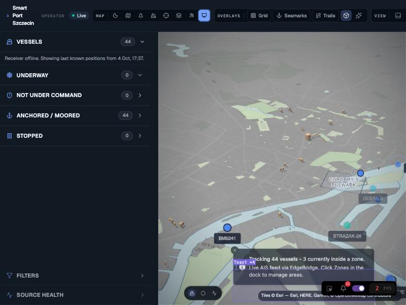

# ADR 0032 - Show the last known positions when the live AIS feed is down

- Status: accepted
- Date: 2026-10-15

## Context

The map only renders vessels pushed over the live WebSocket feed, and the store evicts any vessel without a report for 600 s. When the receiver goes offline the public demo shows an empty map with "Waiting for AIS feed.", even though the API still holds the last known state of every vessel. On 2026-10-04 15:37 UTC the receiver stopped delivering; the map stayed empty for days.

The REST snapshot (`GET /api/vessels`) carries two candidate fixes per vessel: the latest position row and the persisted Kalman state. Position rows can already be gone (on 2026-10-15 all 500 vessels returned `position: null`) while `kalmanState` still holds the last filtered fix with its timestamp.

## Decision

1. Ten seconds after start-up, if the live feed has delivered nothing, the web app fetches the REST snapshot. If its newest fix is older than the 600 s eviction window, the app enters archive mode; fresh data means the feed is only slow to connect, so nothing happens.
2. Archive mode pins a display clock (`displayNowSeconds()`) to the newest fix. Every age-derived view reads that clock instead of the wall clock: store eviction, marker fading, dead reckoning, relative times in the list, geofence ghost sweeps. The snapshot therefore renders exactly as the map looked at that moment, and no existing threshold changes.
3. Only fixes inside the 600 s window before the anchor are seeded, from the position row when present, else from `kalmanState`.
4. The sidebar states it plainly: "Receiver offline. Showing last known positions from <date>."
5. The first live frame newer than the anchor unpins the clock; the regular sweep then evicts the snapshot within 30 s.

## Consequences

- The demo never shows an empty map while the API holds data. Before: 0 vessels. After (2026-10-15, receiver offline since 2026-10-04): 44 vessels.
- Kalman-sourced fixes carry no speed or course, so those vessels render as stationary.
- The API CORS allowlist must include the production origin (`https://sps-radar.pl`); browsers on that origin cannot read `/api/vessels` otherwise.

## Evidence

